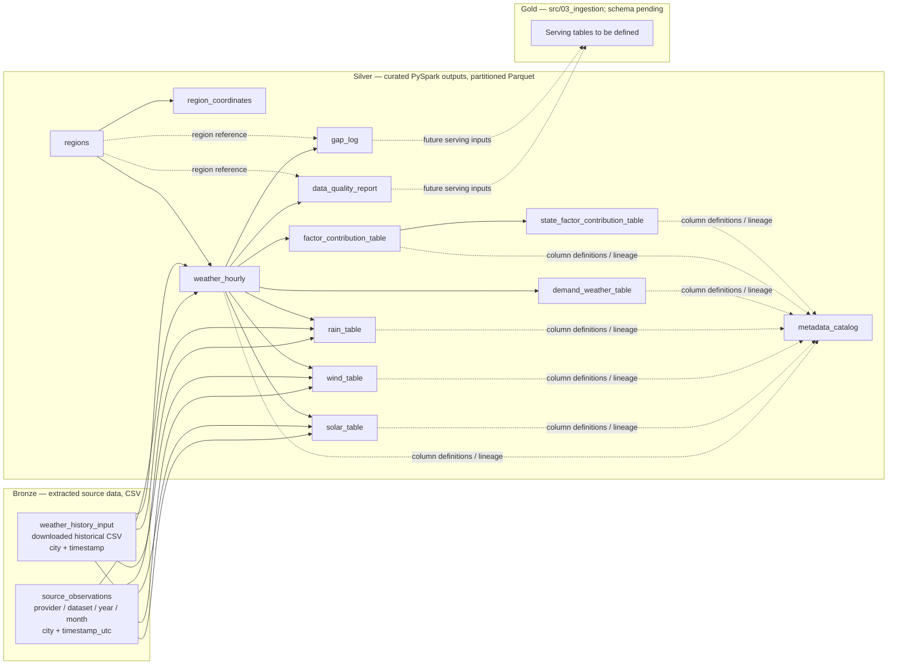

# Weather data model — Medallion architecture

This document models the current source and processing layers. Extracted data is **Bronze**, outputs from `src/02_process` are **Silver**, and `src/03_ingestion` is reserved for the future **Gold** serving model. Gold tables and relations are intentionally undefined pending serving requirements.

## Layer flow



The arrows from Bronze to Silver indicate source lineage: the processing job discovers CSV/Parquet files, maps recognized source fields, and creates curated outputs. A source may populate only the Silver measures it provides; unavailable measurements remain null. The Silver outputs are written under `output/<table>/` and partitioned by `state_code`, `year`, `month`, and `region_id` (static tables use sentinel partitions).

## Bronze — raw extraction outputs

Bronze preserves provider-shaped fields and extraction lineage. Current extractor CSVs are stored as `data/<provider>/<dataset>/year=YYYY/month=MM/<filename>.csv`. The processing input can also include the downloaded historical weather CSV (currently filtered to the selected two-year, three-state source file); the raw input is read-only to the processing job.

| Bronze table / dataset | Physical location / current sources | Grain and natural key | Description |
| --- | --- | --- | --- |
| `solar_observations` | `data/<provider>/solar/.../hourly_solar_radiation.csv`; providers include `nasa_power`, `open_meteo`, `openweather_solar` | One city/coordinate and UTC timestamp; `(provider, city, timestamp_utc)` | Provider-returned solar radiation fields, retaining source names and values. OpenWeather solar access requires a paid product/API key. |
| `weather_observations` | `data/<provider>/weather/.../hourly_weather.csv` | One city/coordinate and UTC timestamp; `(provider, city, timestamp_utc)` | Current/live atmospheric weather fields returned by the provider. |
| `weather_forecast_observations` | `data/<provider>/weather_forecast/.../hourly_weather_forecast.csv` | One city/coordinate and forecast UTC timestamp; `(provider, city, timestamp_utc)` | Forecast values; kept separate from observed/current weather. |
| `historical_weather_input` | User-supplied filtered CSV under `data/` | One source location and timestamp; source dependent | Downloaded Open-Meteo archive/Kaggle weather source read by the Silver processing job. Original source columns are retained in Bronze. |

Provider-specific records may have different columns. Extractor upserts use `(city, timestamp_utc)` within a provider dataset and replace overlapping timestamps, so repeated current runs do not intentionally duplicate those keys.

## Silver — curated processing outputs

Silver outputs are produced by `src/02_process/main.py`. Observation tables use `region_id` and `valid_time_utc` as their principal join key unless noted. The processing code adds source file/checksum, transformation version, source dataset, boundary version, ingestion/update time, and estimate/confidence metadata where applicable.

| Silver table | Primary key / grain | Main relationships and purpose |
| --- | --- | --- |
| `regions` | `region_id`; one city or grid-cell region | Region dimension. Includes state, name/type, centroid, bounding box, and available region attributes. Parent reference for coordinates and observations. |
| `region_coordinates` | `(region_id, latitude, longitude)`; one coordinate associated with a region | `region_id` → `regions.region_id`. Stores coordinate-to-region mapping, distance, weight, and primary-coordinate flag. |
| `weather_hourly` | `(region_id, valid_time_utc)`; one region-hour | `region_id` → `regions.region_id`. Curated canonical weather/time series, including available temperature, humidity, pressure, wind, precipitation, cloud and solar fields. Central Silver fact for downstream feature tables. |
| `solar_table` | `(region_id, valid_time_utc)`; one region-hour | `region_id` → `regions`; derived from `weather_hourly`. Solar measures and solar/PV features such as clear-sky index, cell temperature, derate/capacity factor, generation index, daylight and ramp where source inputs permit. |
| `wind_table` | `(region_id, valid_time_utc)`; one region-hour | `region_id` → `regions`; derived from `weather_hourly`. Wind height adjustment, components, air density, power density, turbine/capacity factors and ramp fields where inputs permit. |
| `rain_table` | `(region_id, valid_time_utc)`; one region-hour | `region_id` → `regions`; derived from `weather_hourly`. Precipitation windows, dry/wet streaks, flood/drought risk and rainfall-only hydro proxy. |
| `demand_weather_table` | `(region_id, valid_time_utc)`; one region-hour | `region_id` → `regions`; derived from `weather_hourly`. Temperature/humidity stress, degree-hours, weather-based cooling/heating load indices and demand-weather index. |
| `factor_contribution_table` | `(region_id, valid_time_utc, factor_name)`; one region-hour-factor | `region_id` → `regions`; factors derive from Silver weather and feature measures. Includes factor value, normalized contribution, direction, method and confidence. |
| `state_factor_contribution_table` | `(state_code, valid_time_utc, factor_name)`; one state-hour-factor | Aggregates `factor_contribution_table` across regions in a state. Uses population weighting when available for every contributing city, otherwise equal-city mean. |
| `data_quality_report` | `(region_id, year, month, variable)`; one region-variable-month | `region_id` → `regions`; summarizes expected/observed/missing hours, duplicates, outliers, estimates and distribution statistics for `weather_hourly`. |
| `gap_log` | `(region_id, valid_time_utc, variable)`; one region-variable-gap observation | `region_id` → `regions`; records missing intervals and gap reason/duration detected from the hourly series. |
| `metadata_catalog` | `(table_name, column_name)`; one Silver column definition | Documents Silver output data types, units, descriptions, formulas/source mappings, transformation rule, license and limitations. |

### Silver relationship notation

```text
regions       | 1 --- > many | region_coordinates
regions       | 1 --- > many | weather_hourly
regions       | 1 --- > many | solar_table
regions       | 1 --- > many | wind_table
regions       | 1 --- > many | rain_table
regions       | 1 --- > many | demand_weather_table
regions       | 1 --- > many | factor_contribution_table
regions       | 1 --- > many | data_quality_report
regions       | 1 --- > many | gap_log
weather_hourly| 1 --- > 1   | solar_table, wind_table, rain_table, demand_weather_table
weather_hourly| 1 --- > many| factor_contribution_table
factor_contribution_table | many --- > 1 | state_factor_contribution_table (state/hour/factor aggregation)
Silver tables  | many --- > 1 | metadata_catalog (table/column documentation; not a row-level FK)
Silver         | --- >       | Gold serving model (to be specified)
```

The `1 --- > 1` notation describes the intended hourly grain, not a database-enforced constraint: rows can be absent when the corresponding source observations or required measures are unavailable. Feature values that are proxies or estimates are identified through estimate/method/confidence metadata.

## Gold — pending serving requirements

`src/03_ingestion` is the planned Gold/serving layer. Its tables, grain, keys, aggregations, consumers, and relationships are not defined yet and should be added after serving-layer requirements are provided.
