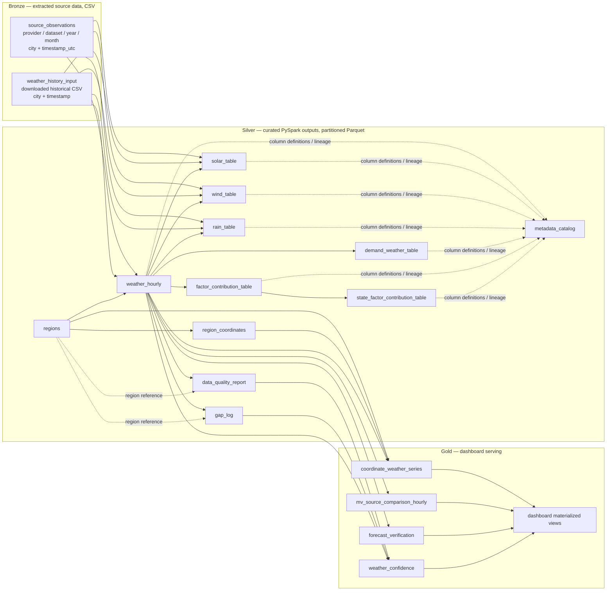

# Weather data model — Medallion architecture

This document models the weather pipeline as a medallion architecture. Extracted data is **Bronze**, outputs from `src/02_process` are **Silver**, and `src/03_ingestion` publishes dashboard-ready **Gold** serving tables and materialized views.

## Layer flow



The arrows from Bronze to Silver indicate source lineage: the processing job discovers CSV/Parquet files, maps recognized source fields, and creates curated outputs. A source may populate only the Silver measures it provides; unavailable measurements remain null. The Silver outputs are written under `output/<table>/` and partitioned by `state_code`, `year`, `month`, and `region_id` (static tables use sentinel partitions).

## Bronze — raw extraction outputs

Bronze preserves provider-shaped fields and extraction lineage. Current extractor CSVs are stored as `data/<provider>/<dataset>/year=YYYY/month=MM/<filename>.csv`. The processing input can also include the downloaded historical weather CSV (currently filtered to the selected two-year, three-state source file); the raw input is read-only to the processing job.

| Bronze table / dataset | Physical location / current sources | Grain and natural key | Description |
| --- | --- | --- | --- |
| `solar_observations` | `data/<provider>/solar/.../hourly_solar_radiation.csv`; providers include `nasa_power`, `open_meteo`, `openweather_solar` | One city/coordinate and UTC timestamp; `(provider, city, timestamp_utc)` | Provider-returned solar radiation fields, retaining source names and values. OpenWeather solar access requires a paid product/API key. |
| `weather_observations` | `data/<provider>/weather/.../hourly_weather.csv` | One city/coordinate and UTC timestamp; `(provider, city, timestamp_utc)` | Current/live atmospheric weather fields returned by the provider. |
| `weather_forecast_observations` | `data/<provider>/weather_forecast/.../hourly_weather_forecast.csv` | One city/coordinate and forecast UTC timestamp; `(provider, city, timestamp_utc)` | Forecast values; kept separate from observed/current weather. |
| `historical_weather_input` | User-supplied filtered CSV under `data/` | One source location and timestamp; source dependent | Downloaded Open-Meteo archive/Kaggle weather source read by the Silver processing job. Original source columns are retained in Bronze. |

Provider-specific records may have different columns. Current/live extractor upserts use `(city, timestamp_utc)` within a provider dataset. Forecast upserts use `(city, timestamp_utc, forecast_issued_at_utc)` so later retrievals preserve earlier forecast vintages for verification.

## Silver — curated processing outputs

Silver outputs are produced by `src/02_process/main.py`. Observation tables use `region_id` and `valid_time_utc` as their principal join key unless noted. The processing code adds source file/checksum, transformation version, source dataset, boundary version, ingestion/update time, and estimate/confidence metadata where applicable.

| Silver table | Primary key / grain | Main relationships and purpose |
| --- | --- | --- |
| `regions` | `region_id`; one city or grid-cell region | Region dimension. Includes state, name/type, centroid, bounding box, and available region attributes. Parent reference for coordinates and observations. |
| `region_coordinates` | `(region_id, latitude, longitude)`; one coordinate associated with a region | `region_id` → `regions.region_id`. Stores coordinate-to-region mapping, distance, weight, and primary-coordinate flag. |
| `weather_hourly` | `(region_id, valid_time_utc)`; one region-hour | `region_id` → `regions.region_id`. Curated canonical weather/time series, including available temperature, humidity, pressure, wind, precipitation, cloud and solar fields. Central Silver fact for downstream feature tables. |
| `solar_table` | `(region_id, valid_time_utc)`; one region-hour | `region_id` → `regions`; derived from `weather_hourly`. Solar measures and solar/PV features such as clear-sky index, cell temperature, derate/capacity factor, generation index, daylight and ramp where source inputs permit. |
| `wind_table` | `(region_id, valid_time_utc)`; one region-hour | `region_id` → `regions`; derived from `weather_hourly`. Wind height adjustment, components, air density, power density, turbine/capacity factors and ramp fields where inputs permit. |
| `rain_table` | `(region_id, valid_time_utc)`; one region-hour | `region_id` → `regions`; derived from `weather_hourly`. Precipitation windows, dry/wet streaks, flood/drought risk and rainfall-only hydro proxy. |
| `demand_weather_table` | `(region_id, valid_time_utc)`; one region-hour | `region_id` → `regions`; derived from `weather_hourly`. Temperature/humidity stress, degree-hours, weather-based cooling/heating load indices and demand-weather index. |
| `factor_contribution_table` | `(region_id, valid_time_utc, factor_name)`; one region-hour-factor | `region_id` → `regions`; factors derive from Silver weather and feature measures. Includes factor value, normalized contribution, direction, method and confidence. |
| `state_factor_contribution_table` | `(state_code, valid_time_utc, factor_name)`; one state-hour-factor | Aggregates `factor_contribution_table` across regions in a state. Uses population weighting when available for every contributing city, otherwise equal-city mean. |
| `data_quality_report` | `(region_id, year, month, variable)`; one region-variable-month | `region_id` → `regions`; summarizes expected/observed/missing hours, duplicates, outliers, estimates and distribution statistics for `weather_hourly`. |
| `gap_log` | `(region_id, valid_time_utc, variable)`; one region-variable-gap observation | `region_id` → `regions`; records missing intervals and gap reason/duration detected from the hourly series. |
| `metadata_catalog` | `(table_name, column_name)`; one Silver column definition | Documents Silver output data types, units, descriptions, formulas/source mappings, transformation rule, license and limitations. |

### Silver relationship notation

```text
regions       | 1 --- > many | region_coordinates
regions       | 1 --- > many | weather_hourly
regions       | 1 --- > many | solar_table
regions       | 1 --- > many | wind_table
regions       | 1 --- > many | rain_table
regions       | 1 --- > many | demand_weather_table
regions       | 1 --- > many | factor_contribution_table
regions       | 1 --- > many | data_quality_report
regions       | 1 --- > many | gap_log
weather_hourly| 1 --- > 1   | solar_table, wind_table, rain_table, demand_weather_table
weather_hourly| 1 --- > many| factor_contribution_table
factor_contribution_table | many --- > 1 | state_factor_contribution_table (state/hour/factor aggregation)
Silver tables  | many --- > 1 | metadata_catalog (table/column documentation; not a row-level FK)
Silver         | --- >       | Gold dashboard facts and materialized views
```

The `1 --- > 1` notation describes the intended hourly grain, not a database-enforced constraint: rows can be absent when the corresponding source observations or required measures are unavailable. Feature values that are proxies or estimates are identified through estimate/method/confidence metadata.

## Gold — dashboard and chart serving model

`src/03_ingestion` publishes read-optimized tables/views for map, time-series, comparison, and summary dashboards. Gold retains source identity so values from Open-Meteo, OpenWeather, NASA POWER, and future providers can be plotted side by side. Do not blend provider readings into one unlabeled value: each point remains attributable to a provider, dataset, measure, and forecast run.

### Gold serving tables

| Gold table / materialized view | Primary key / grain | Relationships and dashboard use |
| --- | --- | --- |
| `coordinate_queries` | `coordinate_id`; one requested or configured latitude/longitude | Dashboard query-point dimension: `(latitude, longitude, state_code)` plus optional label. Coordinates may be in a city, forest, or elsewhere within a state; no city membership is required. Resolve to the best available source/grid cell and record `resolution_method`, `matched_region_id`, `distance_km`, and `coverage_status`. |
| `coordinate_weather_series` | `(coordinate_id, source_id, valid_time_utc, measure_name, scenario_type)`; one coordinate-source-time-measure value | Main map and time-series fact. Joins coordinate, provider/source, Silver region and UTC calendar. Contains value/unit, actual-vs-forecast type, source timestamp, spatial/temporal resolution and lineage. For grid-backed inputs, store/interpolate only according to a declared method; record source grid/region and distance. |
| `source_catalog` | `source_id`; one provider/product/dataset configuration | Provider dimension with provider/product, dataset, measure coverage, units, spatial/temporal resolution, license/cost metadata, and active dates. `source_id` is stable and distinct for products/endpoints from the same provider. |
| `forecast_verification` | `(coordinate_id, forecast_source_id, actual_source_id, forecast_issued_at, valid_time_utc, measure_name)`; one forecast vintage/reference-actual match | Forecast skill fact. Stores forecast value, matched actual value, lead time, signed error (`forecast - actual`), absolute error, squared error, percentage error when actual is nonzero, match status, and sample/quality flags. Enables provider/horizon/variable accuracy charts. |
| `weather_confidence` | `(coordinate_id, source_id, valid_time_utc, measure_name, scenario_type)`; one confidence assessment | Confidence score plus its component scores, evidence counts, coverage and reason codes. Joins the corresponding coordinate series row and Silver quality/coverage inputs. Consumers can filter low-confidence points or display the reason. |
| `mv_coordinate_weather_hourly` | `(coordinate_id, source_id, valid_time_utc, measure_name, scenario_type)`; hourly chart-ready value | Materialized view over coordinate series with consistent UTC/IST calendar fields and dashboard filters. Preserve source and scenario dimensions for overlay charts. |
| `mv_source_comparison_hourly` | `(coordinate_id, valid_time_utc, measure_name, unit, scenario_type, source_id)`; one source series point with comparable-peer statistics | Materialized view that aligns sources into chart series, with per-source value, source count, min/max, median, and spread among rows sharing the same unit. Any aggregate is explicitly labeled; it does not replace individual provider series. |
| `mv_forecast_skill_daily` | `(coordinate_id, forecast_source_id, actual_source_id, measure_name, lead_time_bucket, valid_date)`; one daily skill summary per forecast/reference pair | Materialized view over verification records: matched count, MAE, RMSE, bias/mean error, and MAPE only where defined. Supports daily and selectable-horizon forecast accuracy charts. |
| `mv_coordinate_coverage` | `(coordinate_id, source_id, measure_name, checked_at)`; one source-availability check | Materialized coverage view with nearest available point/grid, distance, latest observed time, latest forecast issue, expected/available hours, missing percentage, and status. Supports maps showing data availability in remote/forest areas. |

### Gold relationships

```text
coordinate_queries | 1 --- > many | coordinate_weather_series
source_catalog     | 1 --- > many | coordinate_weather_series
regions            | 1 --- > many | coordinate_weather_series (optional matched Silver region)
coordinate_weather_series | 1 --- > 1 | weather_confidence (same source/time/measure/scenario key)
coordinate_weather_series | forecast rows --- > actual source rows | forecast_verification
coordinate_weather_series | many --- > 1 | mv_coordinate_weather_hourly (materialized projection)
coordinate_weather_series | many --- > 1 | mv_source_comparison_hourly (aligned source bucket)
forecast_verification | many --- > 1 | mv_forecast_skill_daily (daily/horizon aggregation)
coordinate_weather_series | many --- > 1 | mv_coordinate_coverage (availability aggregation)
```

### Coordinate coverage and confidence rules

- `coordinate_queries` accepts any valid coordinate within Karnataka, Maharashtra, or Tripura; it is not restricted to named cities. A coordinate in an unsampled forest is still a valid dashboard query point, but the response must report whether each source has a direct reading, a grid-cell match, a spatial estimate, or no coverage. Never silently present a distant city reading as a local measurement.
- Prefer a provider's value for the requested coordinate when available. Otherwise use a documented grid-cell match or spatial interpolation only when the source's grid/neighbor data supports it. Include match distance and method in every serving row. If no defensible source value exists, return a coverage row with null value and an explicit no-coverage status.
- Keep actual observations and forecast vintages distinguishable. Forecast key includes `forecast_issued_at` as well as `valid_time_utc`; preserve successive runs so older predictions can be verified against later actuals. Forecast values are never treated as actuals merely because their valid time has passed.
- Confidence is a 0–1 heuristic score with separately queryable components, not a calibrated probability. The current Gold implementation uses weighted source quality (35%), temporal completeness (25%), spatial match quality by distance (25%), and measure availability (15%). It stores component values, score method/version and reason codes so dashboards can explain the score. Missing coverage produces no weather-series confidence row and is exposed in the coverage view.
- A forecast error is computed only when an actual from the selected verification reference source is available for the same coordinate (or explicitly documented matched spatial cell), measure/unit, and valid time. Store the actual source/reference and matching method. Report MAE/RMSE/bias with sample count; MAPE is undefined for zero actuals and should be omitted for those rows rather than divided by zero.

### Forecast-vintage retention requirement

Forecast extractor CSVs retain `forecast_issued_at_utc` in their key alongside city and valid time, preserving forecast vintages going forward. Earlier files may lack this value, so prior overwritten runs cannot be reconstructed. The present Silver processing still normalizes observations into one canonical `weather_hourly` series and does not preserve a provider-by-provider forecast fact; Gold therefore reads source identity and forecast issue time directly from Bronze.

### Dashboard view examples

```text
Map / remote-area coverage:
coordinate_queries | 1 --- > many | mv_coordinate_coverage

Overlay chart by source:
coordinate_queries | 1 --- > many | mv_source_comparison_hourly
source_catalog     | 1 --- > many | mv_coordinate_weather_hourly

Forecast vs actual and skill:
coordinate_weather_series (forecast vintage) | --- compare on coordinate + measure + valid_time --- |
coordinate_weather_series (actual reference) | --- > forecast_verification --- > mv_forecast_skill_daily

Trust indicator:
coordinate_weather_series | 1 --- > 1 | weather_confidence
```
